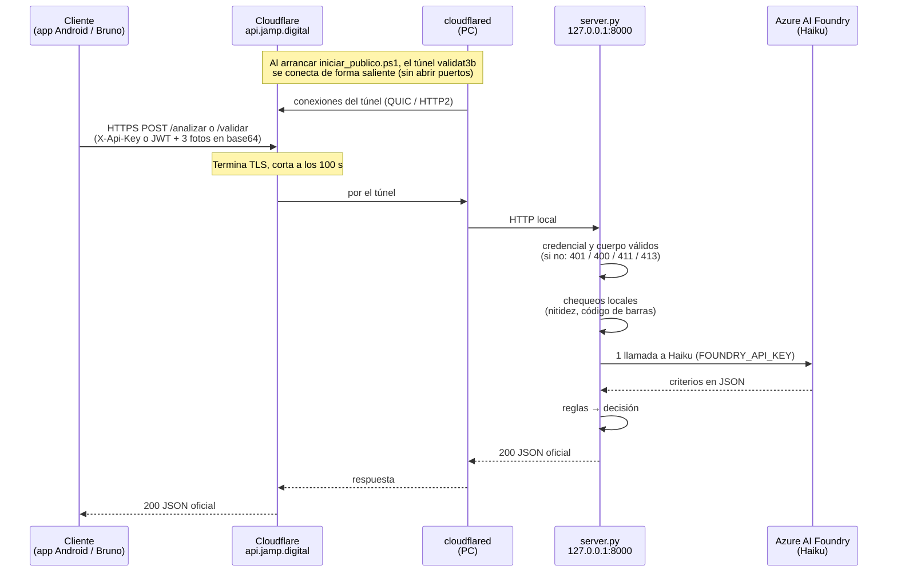

# API Validat3B

Base: `https://api.jamp.digital` (túnel de Cloudflare → `server.py` en el PC). Solo responde si el PC está
encendido y `iniciar_publico.ps1` corriendo.

## Cómo funciona (Cloudflare)
El PC no abre ningún puerto: `cloudflared` marca hacia Cloudflare (conexiones salientes) y Cloudflare le entrega por ese túnel
lo que llega a `api.jamp.digital`. El servidor solo escucha en `127.0.0.1:8000`; la llave de Foundry nunca sale de él.



Si el PC se apaga o `iniciar_publico.ps1` se cierra, Cloudflare sigue respondiendo pero sin origen (502): la app guarda la captura como
*pendiente* y la reenvía cuando la API vuelve. `GET /health` solo recorre cliente → Cloudflare → túnel → `server.py`; no llama a Foundry.

## Autenticación
Todas las peticiones `POST` y `GET /imagenes/...` llevan una de estas dos credenciales (los valores están en `validat3b\.env`):
- `X-Api-Key: <VALIDAT3B_TOKEN>` (token fijo; lo usa Bruno), o
- `Authorization: Bearer <JWT>`: HS256 firmado con `VALIDAT3B_JWT_SECRET` y con `exp` a lo sumo 15 min adelante (se toleran 30 s de desfase
  de reloj; otro `alg` o un `exp` ausente/vencido se rechaza). La app Android genera uno nuevo en cada petición (`ValidatApi.jwt`).

Sin credencial válida: `401 {"error": "token inválido"}`. `GET /health` no pide nada.

## `GET /health`
`200 {"status": "ok", "llm": true}`. `llm: false` significa que el servidor corre con `--no-llm` (todo sale a revisión manual).

## `POST /validar`
Una captura por petición. `Content-Type: application/json` y `Content-Length` obligatorios (no se acepta chunked).

| Campo | Tipo | Requerido | Uso |
|---|---|---|---|
| `facade_b64` | string | sí | Foto de la fachada, imagen (JPEG recomendado) en base64 estándar, sin saltos ni `data:` |
| `product_b64` | string | sí | Foto del producto |
| `shelf_b64` | string | sí | Foto de la etiqueta de precio |
| `capture_store_name` | string | sí | Cadena/tienda seleccionada; se compara contra la fachada |
| `capture_price` | número | no | Precio capturado; se compara contra el de la etiqueta |
| `capture_barcode` | string o número | no | Solo dígitos |
| `product_name` | string | no | Producto esperado (descripción) |
| `capture_brand` | string | no | Marca capturada |
| `unit_quantity_product`, `unit_product` | número, string | no | Contenido esperado, p. ej. `1000`, `"gramo"` |
| `capture_id` | string | no | `[A-Za-z0-9_-]`, máx. 64. Si falta se genera `APP-xxxxxxxx` |

Cuanta más información esperada se envíe (nombre, marca, contenido), mejor puede juzgar el motor. Cualquier otro campo se ignora.
El cuerpo no puede pasar de 40 MB (≈ 3 fotos de 10 MB en base64); la app comprime a JPEG q85.

### Respuesta `200` (igual en `/validar` y `/analizar`)
Un registro con la **misma forma y el mismo orden de llaves que `capturas.json`**, seguido del detalle del motor. Siempre 200 con
registro válido, incluso si algo falla por dentro (en ese caso `revision_manual` / `ERROR_PROCESAMIENTO`).
```json
{
  "capture_id": "PRUEBA-001",
  "capture_store_name": "Soriana",
  "capture_date": "2026-11-19 10:26:48",
  "capture_barcode": 7501032907570,
  "capture_price": 75.9,
  "capture_brand": "Baygon",
  "id_product": 3870,
  "product_name": "Insecticida Casa y Jardin",
  "product_barcode": 7501032907570,
  "product_price": 72.0,
  "min_product_price": 0.0,
  "max_product_price": 124.9,
  "unit_product": "mililitro",
  "unit_quantity_product": 400.0,
  "product_group": "(14) General M",
  "product_line": "(07) Insect Aroma",
  "facade_file": "imagenes/PRUEBA-001_facade.jpg",
  "facade_url": "https://api.jamp.digital/imagenes/PRUEBA-001_facade.jpg",
  "product_file": "imagenes/PRUEBA-001_product.jpg",
  "product_url": "https://api.jamp.digital/imagenes/PRUEBA-001_product.jpg",
  "shelf_file": "imagenes/PRUEBA-001_shelf.jpg",
  "shelf_url": "https://api.jamp.digital/imagenes/PRUEBA-001_shelf.jpg",
  "decision_esperada": "revision_manual",
  "motivo_rechazo": "",
  "confidence_score": 0.5,
  "reason_code": "CANDIDATA_APROBACION",
  "validaciones": {"tienda_fachada": "ok", "producto": "ok", "codigo_barras": "no_evaluable", "evidencia_precio": "ok"},
  "precio_detectado": 75.9,
  "precio_descuento": null,
  "codigo_barras_detectado": null,
  "explicacion": "texto para el analista",
  "fuente_producto": "catalogo"
}
```
Las 24 primeras llaves (hasta `motivo_rechazo`) son las de `capturas.json`:
- `capture_*`: lo que mandó el cliente; si no lo mandó (solo en `/analizar`), lo leído en las fotos. `capture_date` es la que mande el
  cliente o la hora del servidor.
- `id_product`, `product_barcode`, `product_price`, `min/max_product_price`, `product_group`, `product_line`: del catálogo cuando el
  código de barras está en él; si no, `null`. `unit_*` y `product_name`: cliente > catálogo > fotos.
- `capture_barcode` y `product_barcode` van como **número**, igual que en `capturas.json` (se pierden ceros a la izquierda).
- `*_file` / `*_url`: el servidor **guarda las 3 fotos** en `validat3b/salida_api/imagenes/<capture_id>_<facade|product|shelf>.jpg`
  y las sirve en `GET /imagenes/...` con la misma autenticación (un navegador sin el header recibe 401). La URL usa el dominio con
  el que llegó la petición. Si las fotos no se pudieron guardar, van en `null`. Cada registro devuelto también se guarda en
  `validat3b/salida_api/json/<capture_id>.json`.
- `decision_esperada`: la decisión del motor, `aprobada` | `rechazada` | `revision_manual` (el nombre de la llave es el de
  `capturas.json`). **Se aprueba por datos completos** (`APPROVE_POR_DATOS`): si `capture_id`, `capture_store_name`,
  `capture_date`, `capture_barcode`, `capture_price`, `capture_brand` y `product_name` vienen rellenos y las fotos no salen
  borrosas ni lejanas, Haiku marca los 7 criterios (fachada, pantalla, nitidez, cercanía, producto, etiqueta y precio) en `ok` y la
  nitidez medida ≥ 180. No compara el precio capturado con la etiqueta. En las 100 capturas de dev aprobó 27 con 78 % de precisión. Solo
  aplica a la API, la app y la ventana; `run.py` (archivo oficial del set ciego) no la usa. Lo que no cumple va a
  `revision_manual`; el criterio estricto anterior (`ALLOW_APPROVE = False`) deja `CANDIDATA_APROBACION`.
- `motivo_rechazo`: `""` salvo que se rechace; entonces el texto como lo registran los analistas (`Capturas borrosas`,
  `Capturas lejanas`, `Descripción de producto incompleta`, `Foto tomada a la pantalla de otro celular`, `No hay etiqueta de precio`...).

Detalle del motor (después de `motivo_rechazo`):
- `validaciones.*`: `ok` | `falla` | `no_evaluable`.
- `precio_detectado`: precio leído de la etiqueta, o `null`.
- `precio_descuento` (campo propio, **no está en el formato oficial del reto**): precio por pieza de una oferta visible en la
  etiqueta o un letrero junto a ella ("OFERTA", "AHORRA MÁS", precio tachado, "2 x $9.00" → `4.5`); `null` si es precio regular.
  Se valida: debe ser > 0, no mayor que el precio de la etiqueta y dentro de `[min_product_price, max_product_price]` si se
  conocen. Si no pasa, sale `null`, la captura no puede quedar como candidata y la `explicacion` dice por qué. El precio
  capturado se da por confirmado si coincide con el de la etiqueta **o** con el de descuento.
- `codigo_barras_detectado`: código leído de las fotos, o `null`.
- `reason_code` (lista provisional, no es la oficial): `APROBADA`, `PRODUCTO_NO_COINCIDE`, `FOTO_DE_PANTALLA`, `IMAGEN_BORROSA`,
  `CAPTURA_LEJANA`, `FACHADA_INCORRECTA`, `SIN_ETIQUETA_PRECIO`, `DESCRIPCION_INCOMPLETA`, `EVIDENCIA_AMBIGUA`,
  `CANDIDATA_APROBACION`, `SIN_ANALISIS_VISUAL`, `ERROR_PROCESAMIENTO`.
- `fuente_producto`: de dónde salió `product_name`: `usuario` | `catalogo` | `foto` | `null`.
- `fuente_catalogo`: cómo se encontró el producto en el catálogo para rellenar `id_product`, `product_barcode`, los precios de
  referencia, `product_group` y `product_line`: `id_product` (si el cliente lo manda) | `codigo_barras` | `nombre` (nombre + contenido,
  solo si la coincidencia es clara; gramo y mililitro cuentan como compatibles) | `null` (no se encontró: esos campos quedan en `null`).
- La parte oficial del reto (`capture_id`, `decision` = `decision_esperada`, `confidence_score`, `reason_code`, `validaciones`,
  `precio_detectado`, `codigo_barras_detectado`, `explicacion`) se reconstruye con `engine.auto.oficial(registro)`. El archivo del set
  ciego lo sigue generando `run.py` en el formato oficial; este registro es solo la respuesta de la API.

### Errores (el cuerpo siempre es `{"error": "..."}`)
| Código | Causa |
|---|---|
| 400 | JSON inválido, falta una foto o `capture_store_name`, base64 inválido, `capture_id` inválido, `capture_price`/`capture_barcode` no numéricos |
| 401 | Token faltante o incorrecto |
| 404 | Ruta inexistente, o foto que no existe en `GET /imagenes/...` |
| 411 | Falta `Content-Length` |
| 413 | Cuerpo vacío o mayor a 40 MB |

Un 4xx no gasta tokens y no se reintenta tal cual. Un 200 con `ERROR_PROCESAMIENTO` sí se puede reintentar.

## `POST /analizar`
Para la app: solo las 3 fotos (`facade_b64`, `product_b64`, `shelf_b64`) son obligatorias. Cualquier campo de la tabla de `/validar`
(incluido `capture_store_name`) es opcional y, si viene, manda sobre lo detectado. Mismos códigos de error que `/validar`.
La respuesta `200` es el mismo registro de `/validar`; lo que el cliente no mandó se llena con lo que Haiku lee en las fotos.
- Si hay varios códigos en las fotos se prefiere el que está en el catálogo.
- Sin datos esperados, el motor evalúa lo que se ve en las propias fotos (calidad, producto vs. etiqueta, precio legible); no compara
  contra un producto esperado. Para eso usa `/validar` con los datos esperados.
- Si algo falla por dentro: `200` con el registro (lo que mandó el cliente) y `revision_manual` / `ERROR_PROCESAMIENTO`.
- Cuesta lo mismo que `/validar` (~3.9k tokens de entrada, ~0.25k de salida).

## Reglas para el cliente
1. **Timeout de lectura ≥ 90 s.** Con Haiku tarda unos 2–10 s (más si hay cola); Cloudflare corta a los 100 s.
2. **Un `capture_id` único por captura.** El servidor no deduplica: repetir la petición vuelve a gastar ~3.9k tokens y reemplaza
   las fotos guardadas con ese `capture_id`.
3. **Concurrencia baja (2–4 peticiones a la vez).** Todas comparten el límite de tokens por minuto de la llave de Foundry.
4. **No mandar las fotos de 3B por aquí.** Pasan por la red de Cloudflare; las reglas del reto piden mantener esos datos dentro del equipo.
5. La llave de Foundry vive solo en el servidor; el cliente nunca la ve ni la necesita.

## Ejemplo (Python)
```python
import base64, requests
b64 = lambda p: base64.b64encode(open(p, "rb").read()).decode()
r = requests.post("https://api.jamp.digital/validar", timeout=120,
                  headers={"X-Api-Key": "<VALIDAT3B_TOKEN>"},
                  json={"capture_id": "MI-001", "capture_store_name": "Soriana", "capture_price": 14.0,
                        "product_name": "Arena para gato", "capture_brand": "Cat-tit",
                        "unit_quantity_product": 2000, "unit_product": "gramo",
                        "facade_b64": b64("fachada.jpg"), "product_b64": b64("producto.jpg"), "shelf_b64": b64("etiqueta.jpg")})
r.raise_for_status()
print(r.json()["decision_esperada"], r.json()["motivo_rechazo"], r.json()["precio_descuento"])
```
Cliente Android de referencia: `3bApp/app/src/main/java/com/example/a3bapp/ValidatApi.kt`.

## Portal de auditoría

Las tres rutas usan `X-Audit-Token` según la [guía de integración](../INTEGRACION_IMAGENES.md).

| Método y ruta | Resultado |
|---|---|
| GET /auditoria/capturas | Objeto con una lista `casos` ordenada desde la recepción más reciente. Cada registro incluye `revision`, `recibida` y una posible `auditoria`. |
| GET /auditoria/imagenes/{id}_{facade,product,shelf}.jpg | JPEG de la evidencia original. |
| POST /auditoria/capturas/{id}/resolucion | Enviar `revision`, `estado` (aprobada o rechazada), `motivo` y `nota`. Un rechazo requiere motivo y nota. El 201 confirma la decisión persistida. El 409 indica que cambió la evidencia, que el caso no está pendiente o que ya se resolvió. |

Las resoluciones se almacenan separadas de los dictámenes en `salida_api/auditoria.sqlite`. Si se reemplaza el contenido de un registro con el mismo ID, su versión cambia y requiere una nueva revisión.
